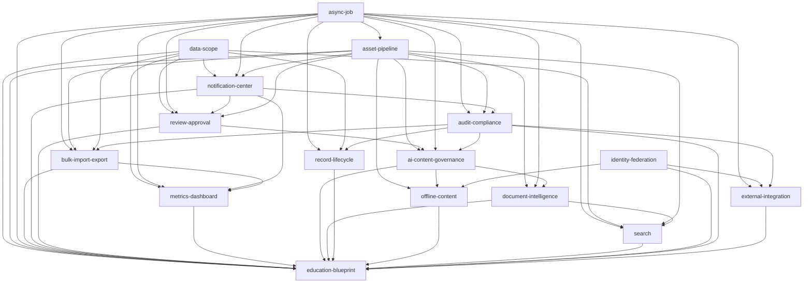

# 今天新增 changes 的依赖关系与实施顺序

> 范围：`9132128` / `ffc9d31` 新增的 16 个 OpenSpec changes。
> 目标：给出依赖图、拓扑顺序与实施波次；实施从第一波开始。

## 1. 依赖图



## 2. 拓扑顺序（实施波次）

### Wave 0：前置（本会话先做）

1. `add-generic-data-scope-authorization` — 数据范围原语，审批/指标/导入/搜索/教育蓝图都依赖。
2. `add-async-job-and-callback-facade` — 通用异步任务，资产/审批/导入/指标/AI/文档都依赖。

### Wave 1：平台基础（可并行）

3. `add-identity-federation-and-session-governance`
4. `add-asset-and-media-pipeline`（依赖 async-job）
5. `add-notification-center-and-announcements`（依赖 data-scope/async-job/asset）
6. `add-audit-compliance-and-tamper-evidence`（依赖 async-job/asset/notification）

### Wave 2：业务平台能力

7. `add-review-and-approval-platform`（依赖 data-scope/async-job/asset/notification）
8. `add-bulk-import-export-framework`（依赖 async-job/asset/data-scope/audit）
9. `add-external-integration-connector`（依赖 async-job/identity/audit）
10. `add-record-lifecycle-and-tree-operations`（依赖 async-job/data-scope/audit）

### Wave 3：数据与 AI 能力

11. `add-metrics-and-dashboard-platform`（依赖 data-scope/async-job/notification/bulk-import-export）
12. `add-ai-content-governance`（依赖 asset/review-approval/async-job/audit）
13. `add-document-intelligence`（依赖 asset/async-job/ai-content-governance/approval）

### Wave 4：交付与增强

14. `add-offline-content-package`（依赖 asset/ai-content-governance/identity/data-scope）
15. `add-search-and-retrieval`（依赖 async-job/data-scope/asset/document-intelligence）
16. `add-education-reference-blueprint`（依赖以上全部；最后安装/验收）

## 3. 关键路径

```text
data-scope ─┐
            ├─ review-approval ─ ai-content-governance ─ document-intelligence ─ education-blueprint
async-job ──┘        │                    │
                     └─ notification ─────┘
async-job ─ asset ──┘

data-scope ─ metrics-dashboard ─ education-blueprint
async-job ─ bulk-import-export ─ metrics-dashboard
identity ─ external-integration / offline-content
```

最短关键路径（按依赖深度）：`data-scope → review-approval → ai-content-governance → document-intelligence → education-blueprint`。
`async-job → asset → review-approval` 与 `async-job → bulk-import-export → metrics` 可并行。

## 4. 实施约定

- 每个 change 先完成“纯逻辑 + 表/迁移 + 单测”，再接 API/UI。
- 不跨 change 提前实现下游；下游只通过已完成的接口/表接入。
- 每个 change 完成后更新 `tasks.md` 复选框并重新生成 `docs/OPENSPEC_CHANGES.md`；CI 会校验。
- 平台核心实现放 `libs/platform-core`，`apps/api` 只做装配/兼容壳；测试放 `apps/api/src/**/*.spec.ts`（Jest rootDir 约定）。
- 迁移/RLS/DOMAIN 文档与实现同 PR；不把教育词写进平台表。

## 5. 本会话起始检查点

- 先实施 `add-generic-data-scope-authorization`：类型/AST、纯解析器、实体、DDL/迁移、RLS、单测。
- 再实施 `add-async-job-and-callback-facade`：后续波次的第一块。
- 每个检查点跑：
  ```bash
  npm run build --workspace @sap/platform-core
  npm run test --workspace @sap/api -- --runInBand <spec>
  npm run check:openspec-ledger
  ```
