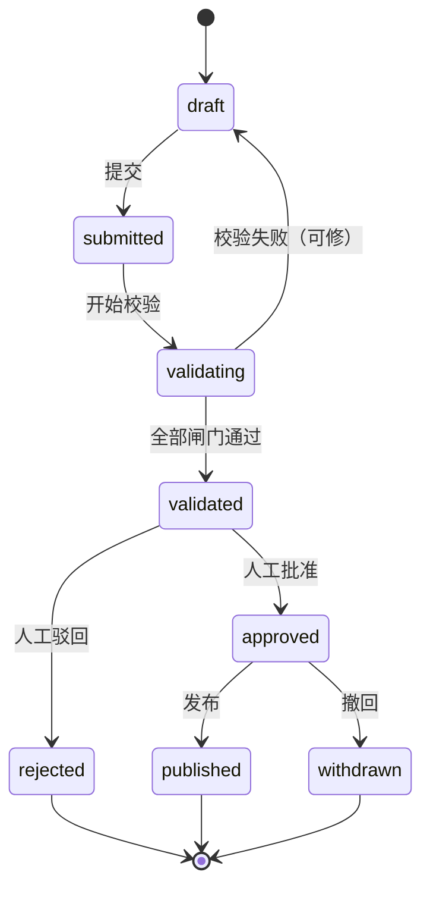
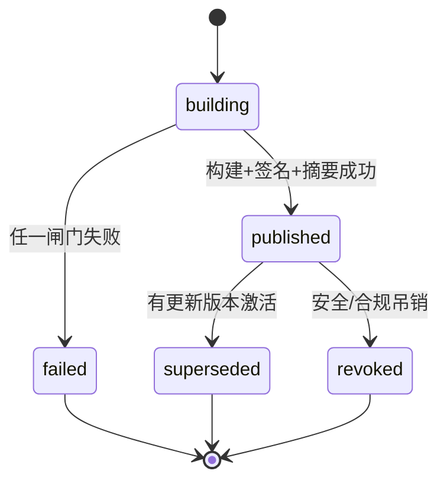
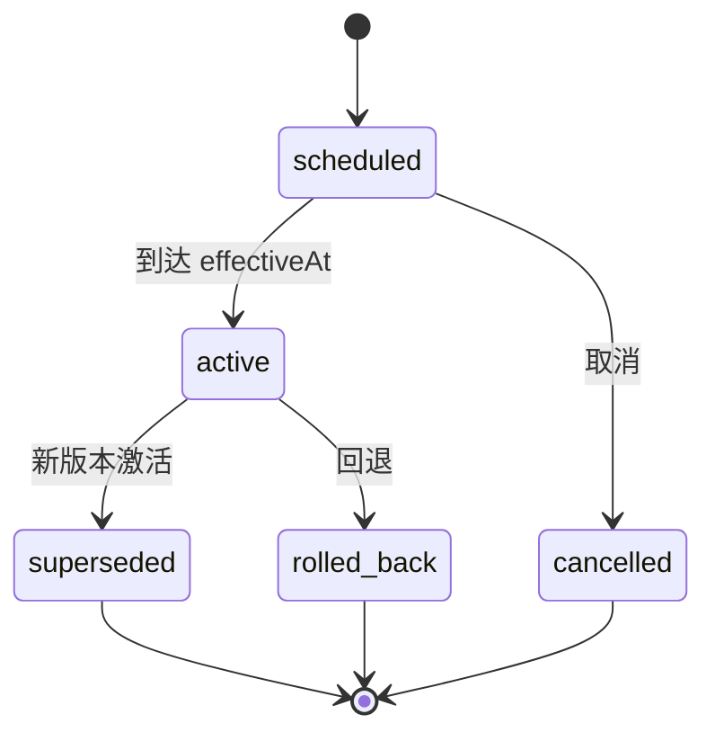

# 发布与激活协议（真源）

> 本文由参考包 `docs/protocols/release.md` 并入，是 Release / Activation / Rollback 的真源。
> 相关不变量见 `docs/META_LANGUAGE.md` 与 `DOMAIN.md`。

> 目标：让“管理员用 AI 更新系统”变成**有版本、可审批、可灰度、可回退、业务人员可见**的工程流程。
> 关键区分：**部署进程 ≠ 发布业务版本 ≠ 对租户激活**。
> 三者混在一起，是“AI 改了系统但没人知道改了哪版、出事退不回去”的根因。

---

## 0. 三个动作，三个词

| 动作 | 英文 | 做什么 | 回退方式 |
|---|---|---|---|
| 部署 | `deploy` | 把新代码/新进程放到服务器 | 回滚进程/镜像 |
| 发布 | `publish` | 把一份业务定义冻结成不可变 `Release` | 不能改；只能发新版本 |
| 激活 | `activate` | 让某个租户/人群使用某个 `Release` | 追加一条回退激活记录 |

**发布不等于上线**。发布只是“制品存在”；激活才是“业务人员看到”。
**部署不等于发布**。代码可以先部署，Release 后激活；回退 Release 不需要回滚代码
（前提是代码兼容旧 Release，见 §8）。

如果团队希望“发布即对全部租户可见”，可以把激活配置成发布后的自动步骤（`autoActivate: all`）；
但系统仍然写一条 activation 记录，回退仍然走 activation，不破坏可追溯性。

---

## 1. 对象

| 对象 | 作用 | 生命周期 | 真源 |
|---|---|---|---|
| `BusinessApp` | 一个业务系统（`appKey`） | 长期 | `app_installations.appKey` |
| `AppDraft` | 可编辑工作副本 | 一次发布周期 | `app_drafts` |
| `ChangeProposal` | 一次变更提议（AI 或人起草） | 提议周期 | `app_change_proposals` |
| `Release` | 不可变发布物 | 永久只读 | `app_releases` + `manifest` |
| `ReleaseItem` | 发布中的单项变更（便于 diff/影响面） | 随 Release | `app_release_items` |
| `Activation` | 某 org/cohort 使用某 Release | 追加记录 | `app_release_activations` |
| `Approval` | 审批记录 | 随提议/发布 | `app_release_approvals` |
| `ReleaseEvent` | 发布/激活/回退事件流 | 永久 | `app_release_events` |
| `Feedback` | 业务人员反馈 | 闭环周期 | `agent_feedback` |
| `SkillSet` | PiAgent 提示词/技能集 | 随 Release | `agent_skill_versions` |
| `KnowledgeEntry` | 已发布知识条目 | 只追加版本 | `agent_knowledge_entries` |

### 1.1 与现有资产的关系

```text
ai_modules（六步定义 / 测试 / 评审）
   └─ definition-to-blueprint
        └─ Blueprint 包（semantic/flows/rules/experience/license）
             └─ blueprint compile + digest + license
                  └─ app_releases（本文件新增：不可变发布目录）
                       └─ app_release_activations（本文件新增：租户/cohort 生效）
                            └─ app_installations（现有：租户当前安装）
                                 └─ app_installation_revisions（现有：安装/升级/回滚历史）
```

- **不要另起一套定义编辑器**：`ai_modules` 已经是“定义→测试→评审→发布”的雏形；
  本文件把它提升为 `ChangeProposal` 的一种来源，补齐不可变 Release 与 Activation。
  `app_drafts` 不是新的编辑器，而是**发布周期的工作副本**：AI 六步定义、手工编辑、
  导入的 Blueprint 最终都落到同一份 draft，再走发布。
- `app_installation_revisions` 记录“这个安装发生过什么”；`app_release_activations` 记录
  “为什么、对谁、什么时候生效”。两者都保留，不合并。迁移期可继续用
  `app_installations.blueprintVersion/releaseDigest` 作为当前版本快照，新增 `currentReleaseId` 是可选项，不强制。
- Blueprint 的 `manifest` / `releaseDigest` / 验签继续是发布物的格式真源；
  `app_releases.manifest` 是它的目录级快照，不替代包内 `manifest.json`。

---

## 2. 状态机

### 2.1 提议



规则：

- `validating` 失败必须回到 `draft`，不允许“带警告发布”。
- `approved` 不是终态；批准后仍可撤回，但已发布不能撤回。
- 提议被驳回时，关联反馈退回 `triaged`，下一轮还能用。

### 2.2 发布



规则：

- `published` 之后**内容字段只读**；只允许状态改为 `superseded` / `revoked`。
- `failed` 的构建产物不进目录，不占用版本号（或标记为 `-failed` 内部版本，不对业务可见）。
- `revoked` 是“不能再激活”，不是“删除”；历史仍可查。

### 2.3 激活



规则：

- 激活记录只追加；修改计划 = 取消旧记录 + 新增记录。
- 同一 `appInstallationId` 同时只能有一条 `active` 且 `cohort is null` 的记录。
- 灰度 cohort 可以有多条 `active`，但 cohort 必须唯一且显式。
- 回退产生 `action=rollback` 的新记录，不修改旧记录。

---

## 3. 版本语义

### 3.1 semver

`MAJOR.MINOR.PATCH`，可选预发布：

```text
1.4.0
1.4.0-rc.1
1.4.0-canary.1
```

- `MAJOR`：破坏性变更。
- `MINOR`：向后兼容的新增。
- `PATCH`：向后兼容的修复/文案。
- 预发布版本只能进 `preview` / `canary` 通道，不能直接 `stable`。
- **channel 是构建通道，灰度是激活策略**：`canary` 版本激活到 100% 仍是 canary，不等于 stable；
  要转 stable 必须发布一个 stable 版本（`1.4.0`），不能只改激活比例。

### 3.2 变更分级

| 变更 | 级别 | 判据 |
|---|---|---|
| 删除/重命名实体、字段、枚举值 | MAJOR | 旧数据/旧客户端无法解析 |
| 字段类型不兼容（string→number、精度降低） | MAJOR | 需要数据迁移且不可逆 |
| 收紧权限（角色失去原本可见的页面/字段） | MAJOR | 业务人员会“突然看不到” |
| 删除流程边/工具/菜单 | MAJOR | 已有任务/自动化会断 |
| 新增必填字段且无默认值 | MAJOR | 旧数据不满足 |
| 新增实体/字段/表单/页面/流程 | MINOR | 旧数据仍可读 |
| 新增可选字段、放宽校验 | MINOR | 向后兼容 |
| 新增工具/技能/知识条目 | MINOR | 旧会话不受影响 |
| 文案、提示、帮助、校验消息 | PATCH | 不改结构 |
| 性能/索引/日志 | PATCH | 不改语义 |
| 修 bug 但改变可见行为 | MINOR | 业务能感知 |

**判定争议**：按“旧客户端/旧数据是否还能正常工作”判，不按“改动行数”判。

### 3.3 版本号与 digest 的关系

- 版本号是**人读**的语义；digest 是**机器**的内容指纹。
- 同一个版本号不允许对应两个 digest；发布前平台重算，不一致即拒（INV-REL-02）。
- 版本号一旦发布不可复用；即使 `revoked` 也不复用。

---

## 4. Release 包含什么

```jsonc
{
  "release": "release/v1",
  "appKey": "erp-purchase",
  "version": "1.4.0",
  "channel": "stable",                  // preview | canary | stable
  "baseReleaseId": "rel_01J...",
  "source": {
    "draftId": "drf_01J...",
    "proposalIds": ["chg_01J...", "chg_01K..."]
  },
  "artifacts": {
    "semantic":    { "digest": "sha256:...", "schema": "blueprint-semantic/v1" },
    "forms":       { "digest": "sha256:..." },
    "flows":       { "digest": "sha256:...", "schema": "blueprint-flows/v1" },
    "rules":       { "digest": "sha256:...", "schema": "blueprint-rules/v1" },
    "experience":  { "digest": "sha256:...", "schema": "blueprint-experience/v1" },
    "permissions": { "digest": "sha256:..." },
    "menus":       { "digest": "sha256:..." },
    "agent": {
      "tools":     { "digest": "sha256:..." },
      "skills":    { "version": "sk_01J...", "digest": "sha256:..." },
      "knowledge": { "version": "kn_01J...", "digest": "sha256:..." }
    },
    "migrations":  [{ "id": "m_01J...", "digest": "sha256:...", "rollbackSafe": true }]
  },
  "compatibility": {
    "minRuntime": "1.0.0",
    "dataSchema": "2026_10_30",
    "rollbackSafe": true                // false = 兼容期内禁止回退
  },
  "changelog": {
    "zh-CN": [
      { "type": "added", "title": "采购单支持税率", "detail": "..." },
      { "type": "changed", "title": "供应商选择改为搜索", "detail": "..." }
    ]
  },
  "digest": "sha256:...",
  "signature": "ed25519:...",
  "publishedAt": "2026-10-30T12:00:00Z",
  "publishedBy": "usr_01J..."
}
```

要求：

- `artifacts` 每一项都有 digest；缺一项视为不完整。
- `agent.skills` / `agent.knowledge` 必须绑定版本；不能用“最新”这种浮动引用。
- `changelog` 是**面向业务人员**的语言，不是 schema diff。
- `migrations` 必须标 `rollbackSafe`；不安全的迁移要带补偿计划。
- `signature` 复用 Blueprint 的 Ed25519 验签链（见 `docs/protocols/blueprint-delivery.md`）。

---

## 5. 发布流水线：G0–G8

```text
Draft
  → G0 契约一致性
  → G1 Schema / Blueprint 编译
  → G2 权限差异审查
  → G3 迁移 dry-run + 回退计划
  → G4 测试
  → G5 Agent 评测（涉及 Agent 时）
  → G6 预览冒烟
  → G7 人工审批
  → G8 发布（冻结/签名/摘要/变更日志）
```

| 闸 | 判什么 | 失败 | 证据 |
|---|---|---|---|
| G0 | `check:domain` / `check:meta` / `check:agent-tools` 全绿 | 拒绝构建 | CI 报告 |
| G1 | Blueprint 编译、Schema 校验、引用完整性、冲突检测 | 拒绝构建 | 编译记录 + IR digest |
| G2 | 权限新增/收紧/删除；谁获得/失去什么 | 高风险需安全审批 | 权限 diff 表 |
| G3 | 迁移在影子库 dry-run；回退计划可执行 | 拒绝发布 | 迁移日志 + 回退脚本 |
| G4 | 单测/集成/E2E/冒烟 | 拒绝发布 | 测试报告 |
| G5 | 工具选择、答疑准确率、写操作安全、越权率 | 低于阈值拒绝 | `agent_eval_runs` |
| G6 | 预览环境关键路径可走通 | 拒绝审批 | Playwright 录像/截图 |
| G7 | 作者 ≠ 批准人；高风险双人 | 拒绝发布 | 审批记录 |
| G8 | 摘要重算、签名、changelog、不可变写入 | 失败回滚构建 | Release 行 + 事件 |

### 5.1 闸门矩阵

| 变更类型 | G1 | G2 | G3 | G4 | G5 | G6 | G7 |
|---|---|---|---|---|---|---|---|
| 文案/帮助 | - | - | - | 冒烟 | - | 可选 | 应用负责人 |
| 表单/页面 | ✅ | 涉及权限时 | - | ✅ | 涉及工具时 | ✅ | 应用负责人 |
| 数据模型 | ✅ | ✅ | ✅ | ✅ | 涉及工具时 | ✅ | 负责人 + 技术负责人 |
| 流程/规则 | ✅ | 涉及权限时 | 可能 | ✅ | 涉及 Agent 时 | ✅ | 应用负责人 |
| 权限/菜单 | ✅ | ✅ | - | ✅ | ✅ | ✅ | 负责人 + 安全 |
| 工具/技能/知识 | ✅ | ✅ | - | ✅ | ✅ | ✅ | 负责人 + 安全 |
| 迁移 | ✅ | ✅ | ✅ | ✅ | - | ✅ | 负责人 + 技术负责人 |

**没有“免检”变更**。文案也要冒烟，因为文案可能出现在审批意见/合同/对账单上。

---

## 6. 预览、灰度、激活

### 6.1 预览

- 预览 Release：`channel=preview`，**业务用户不可见**。
- 预览 token：签名 JWT，绑定 `userId + organizationId + releaseId + roles`，TTL ≤ 24h。
- 预览环境用**脱敏样本数据**或只读副本；禁止在预览里写生产库。
- 对比模式：同一页面并排显示“当前版本 / 预览版本”，标出新增、删除、改文案、改权限。
- 预览链接可分享给审批人，但每次访问都记审计。

### 6.2 灰度

- 目标可以是：组织、部门、角色、用户列表、百分比。
- 建议节奏：`5% → 25% → 100%`，每档至少一个观察窗口（默认 24h）。
- 观察指标：错误率、任务完成率、关键流程耗时、PiAgent 工具失败率、答疑差评率。
- 护栏阈值必须在激活前配置；未配置则默认**只允许人工回退**，不自动回退。

### 6.3 激活

- 激活是**追加记录**；`effectiveAt` 可以未来时间。
- 同一安装同一时刻只能有一个非 cohort 的 `active`。
- 同一 `appKey` 的不同 org 可以停留在不同 Release；这是**正常的多版本共存**，不是代码分叉。
  禁止的是同一个 org 内维护多套互不一致的业务定义分支。
- 激活后：
  1. 递增 `cache:release:active` 版本；
  2. `revalidateTag('release:<appKey>')`；
  3. 发 Outbox 事件 `release.activated`；
  4. 通知受影响的用户（站内信/邮件，按配置）；
  5. 记录 `ReleaseEvent`。

---

## 7. 业务人员看到什么

“看到新系统”不能只是“刷新后页面变了”。必须有可解释的变更入口：

| 入口 | 内容 | 数据来源 |
|---|---|---|
| 首次登录提示 | “本次更新：新增税率字段、供应商搜索、修复对账导出” | `release.changelog` |
| 更新记录页 | 按版本分组的 changelog，可回看 | `app_releases` |
| 菜单/页面徽标 | `NEW` / `UPDATED`，按用户上次看到的版本计算 | `release_items` + `app_user_release_views` |
| PiAgent 答疑 | “这个字段是 v1.4 新增的，用来……”并引用版本 | Context Envelope + knowledge |
| 变更对比（管理员） | 结构 diff、权限 diff、影响面 | `release-kernel diff` |

规则：

- 业务人员只看到**自己 org 当前激活版本**的 changelog；看不到未激活版本。
- 灰度用户看到“体验版”标识，并可一键反馈；反馈自动带 `releaseId + cohort`。
- PiAgent 不得提及未激活版本的功能；用户问到时回答“当前版本还没有”，不泄露路线图。
- 不同 org 可能在不同版本：帮助文档、PiAgent 知识、截图文案都必须带版本维度。

---

## 8. 回退

### 8.1 回退什么

| 层 | 能否回退 | 方式 |
|---|---|---|
| 业务定义 Release | ✅ | 重新激活旧 Release，追加 activation |
| 进程/代码 | ✅ | 部署旧镜像 |
| 数据迁移 | 视情况 | 补偿迁移；禁止整库快照回滚单租户 |
| 已发送通知/外部副作用 | ❌ | 只能发更正，不能撤回 |

### 8.2 回退前置条件

1. 目标 Release 仍存在且未被 `revoked`。
2. 目标 Release 的数据 schema 与当前数据兼容（expand/contract 的兼容期）。
3. 若当前 Release 含破坏性迁移，必须满足其一：
   - `compatibility.rollbackSafe=true`；
   - 已执行补偿迁移并通过 dry-run；
   - 明确接受数据丢失并在审批里签字（默认禁止）。
4. 回退原因、影响范围、通知对象已填写。

### 8.3 回退执行

```text
选择目标 Release
  → 兼容性检查
  → 生成回退 activation（action=rollback, from, to, reason）
  → 失效缓存 / 重验证
  → 发 release.rolled_back 事件
  → 通知受影响用户
  → 审计 + 事故记录
```

**禁止**：

- 直接 `UPDATE app_releases SET manifest=...` 回退。
- 删除新 Release 行。
- 用数据库快照覆盖整个库来“回退一个租户”。
- 在未检查数据兼容性时直接切旧版本。

---

## 9. 数据模型（DDL 草案）

> 表名与列名是提案，采用时按 `DOMAIN.md` 登记。DDL 用 snake_case 表达；若继续用 TypeORM 默认命名，
> 实际列名为 camelCase，`DOMAIN.md` 以 manifest 的实际列名为准。除目录子表 `app_release_items`（通过 `releaseId` 继承租户）外，
> 各表都带 `organization_id`；`app_releases.organization_id` 为 NULL 表示平台级发布。

### 9.1 `app_drafts`

```sql
create table app_drafts (
  id uuid primary key default gen_random_uuid(),
  organization_id uuid not null,
  app_key text not null,
  base_release_id uuid null references app_releases(id),
  status text not null default 'draft' check (status in ('draft','frozen','archived')),
  revision integer not null default 1,
  content jsonb not null default '{}'::jsonb,
  created_by uuid null,
  created_at timestamptz not null default now(),
  updated_at timestamptz not null default now(),
  unique (organization_id, app_key, revision)
);
```

### 9.2 `app_change_proposals`

```sql
create table app_change_proposals (
  id uuid primary key default gen_random_uuid(),
  organization_id uuid not null,
  app_key text not null,
  draft_id uuid not null references app_drafts(id),
  base_release_id uuid null references app_releases(id),
  type text not null check (type in ('copy','form','data','flow','rule','permission','agent','knowledge')),
  areas text[] not null default '{}',      -- 跨多个变更类时列出全部
  status text not null default 'draft'
    check (status in ('draft','submitted','validating','validated','approved','published','rejected','withdrawn')),
  title text not null,
  summary text not null,
  diff jsonb not null,
  evidence jsonb not null default '[]'::jsonb,
  risk jsonb not null default '{}'::jsonb,
  test_plan jsonb not null default '{}'::jsonb,
  rollback_plan jsonb not null default '{}'::jsonb,
  created_by_agent text null,
  created_by uuid null,
  approved_by uuid null,
  approved_at timestamptz null,
  published_release_id uuid null references app_releases(id),
  created_at timestamptz not null default now(),
  updated_at timestamptz not null default now()
);
create index idx_app_proposals_app_status on app_change_proposals (organization_id, app_key, status, created_at desc);
```

### 9.3 `app_releases`

```sql
create table app_releases (
  id uuid primary key default gen_random_uuid(),
  organization_id uuid null,          -- null = 平台级发布
  app_key text not null,
  version text not null,
  channel text not null check (channel in ('preview','canary','stable')),
  status text not null default 'building'
    check (status in ('building','published','superseded','revoked','failed')),
  base_release_id uuid null references app_releases(id),
  manifest jsonb not null,
  changelog jsonb not null,
  compatibility jsonb not null default '{}'::jsonb,
  digest text not null,
  signature text not null,
  published_at timestamptz null,
  published_by uuid null,
  created_by uuid null,
  created_at timestamptz not null default now(),
  updated_at timestamptz not null default now()
);
create unique index uq_app_releases_platform
  on app_releases (app_key, version)
  where organization_id is null;
create unique index uq_app_releases_tenant
  on app_releases (organization_id, app_key, version)
  where organization_id is not null;
```

### 9.4 `app_release_items`

```sql
create table app_release_items (
  id uuid primary key default gen_random_uuid(),
  release_id uuid not null references app_releases(id) on delete cascade,
  item_type text not null
    check (item_type in ('entity','field','relation','form','page','flow','rule','permission','menu','tool','skill','knowledge','migration')),
  item_key text not null,
  change_type text not null check (change_type in ('added','changed','removed','deprecated')),
  before_digest text null,
  after_digest text null,
  payload jsonb null,
  unique (release_id, item_type, item_key)
);
create index idx_app_release_items_release on app_release_items (release_id, item_type);
```

### 9.5 `app_release_activations`

```sql
create table app_release_activations (
  id uuid primary key default gen_random_uuid(),
  organization_id uuid not null,
  app_installation_id uuid not null references app_installations(id),
  release_id uuid not null references app_releases(id),
  action text not null check (action in ('activate','upgrade','rollback')),
  status text not null default 'scheduled'
    check (status in ('scheduled','active','superseded','rolled_back','cancelled')),
  cohort jsonb null,                         -- {type:'percentage',value:10} / {type:'role',ids:[...]}
  effective_at timestamptz not null default now(),
  activated_at timestamptz null,
  activated_by uuid null,
  reason text null,
  from_release_id uuid null references app_releases(id),
  created_at timestamptz not null default now()
);
create unique index uq_app_activation_single_active
  on app_release_activations (app_installation_id)
  where status = 'active' and cohort is null;
```

### 9.6 `app_release_approvals`

```sql
create table app_release_approvals (
  id uuid primary key default gen_random_uuid(),
  proposal_id uuid null references app_change_proposals(id),
  release_id uuid null references app_releases(id),
  approver_id uuid not null,
  role text not null check (role in ('owner','tech_lead','security','platform_admin')),
  decision text not null check (decision in ('approved','rejected')),
  comment text null,
  created_at timestamptz not null default now()
);
```

### 9.7 `app_release_events`

```sql
create table app_release_events (
  id uuid primary key default gen_random_uuid(),
  release_id uuid not null references app_releases(id),
  organization_id uuid null,
  event text not null,
  actor_id uuid null,
  actor_agent text null,
  payload jsonb not null default '{}'::jsonb,
  created_at timestamptz not null default now()
);
```

### 9.8 `app_user_release_views`

```sql
create table app_user_release_views (
  id uuid primary key default gen_random_uuid(),
  organization_id uuid not null,
  user_id uuid not null references sys_users(id),
  app_installation_id uuid not null references app_installations(id),
  last_seen_release_id uuid not null references app_releases(id),
  first_seen_at timestamptz not null default now(),
  last_seen_at timestamptz not null default now(),
  unique (user_id, app_installation_id)
);
```

用途：计算 `NEW` / `UPDATED` 徽标，以及“首次登录提示”是否已读。它是**每用户每应用**的游标，
不是发布真相；丢了可以从 `release_items` 重建。

### 9.9 不可变触发器


```sql
create or replace function app_release_guard() returns trigger as $$
begin
  if old.status = 'published' then
    if new.status not in ('published','superseded','revoked') then
      raise exception 'published release status cannot change to %', new.status;
    end if;
    if new.manifest is distinct from old.manifest
       or new.changelog is distinct from old.changelog
       or new.digest is distinct from old.digest
       or new.version is distinct from old.version
       or new.app_key is distinct from old.app_key then
      raise exception 'published release is immutable';
    end if;
  end if;
  return new;
end $$ language plpgsql;

create trigger trg_app_release_guard
before update on app_releases
for each row execute function app_release_guard();

create or replace function app_release_no_delete() returns trigger as $$
begin
  raise exception 'release rows are append-only';
end $$ language plpgsql;

create trigger trg_app_release_no_delete
before delete on app_releases
for each row execute function app_release_no_delete();
```

> 触发器是最后防线；服务层仍要做校验与测试。两者都要有，不能只靠一层。

---

## 10. API 草案

### 10.1 管理端（Builder）

```text
POST /api/builder/apps/:appKey/drafts
GET  /api/builder/apps/:appKey/drafts/:id
POST /api/builder/proposals
GET  /api/builder/proposals/:id
POST /api/builder/proposals/:id/validate
POST /api/builder/proposals/:id/preview
POST /api/builder/proposals/:id/approve
POST /api/builder/proposals/:id/reject
POST /api/builder/releases/:id/publish
POST /api/builder/releases/:id/activate
POST /api/builder/releases/:id/rollback
GET  /api/builder/releases/:id/impact
GET  /api/builder/releases/:id/changelog
GET  /api/builder/apps/:appKey/releases
```

### 10.2 业务端（Runtime）

```text
GET /api/apps/:appKey/release                 当前激活版本（含 changelog 摘要）
GET /api/apps/:appKey/whats-new               未读变更
POST /api/apps/:appKey/whats-new/:id/read     标记已读
GET /api/apps/:appKey/preview/:token          预览版本（签名 token）
```

### 10.3 命令约定

- 所有写命令必须 `Idempotency-Key`。
- 发布/激活/回退是长任务：返回 `202 + jobId`，通过 SSE/轮询查状态。
- 审批返回明确的 `CONFLICT`：状态已变、作者=批准人、缺少第二审批人。

---

## 11. 权限与职责分离

| 动作 | 权限点 | 谁 | 约束 |
|---|---|---|---|
| 查看发布 | `app:release:read` | 应用成员 | 只能看自己 org 可见的 |
| 起草提议 | `app:release:propose` | 应用负责人/Builder Agent | Agent 需 `allowedAgents` |
| 校验/预览 | `app:release:validate` | 应用负责人/Builder Agent | 预览 token 绑定 |
| 批准 | `app:release:approve` | 应用负责人 | **作者 ≠ 批准人** |
| 安全批准 | `app:release:approve:security` | 安全角色 | 权限/工具/知识变更必需 |
| 发布 | `app:release:publish` | 平台管理员/应用负责人 | 批准后才可 |
| 激活 | `app:release:activate` | 应用负责人/平台管理员 | 目标 org/cohort |
| 回退 | `app:release:rollback` | 应用负责人/平台管理员 | 兼容性检查 |

**职责分离**：

- 起草者不能批准自己的提议；Agent 起草的提议必须由人批准。
- 高风险变更（权限/工具/知识/迁移）需要第二审批人（安全或技术负责人）。
- 平台管理员可以紧急发布，但必须留 `emergency=true` + 事后复核记录。

---

## 12. 可追溯与影响面

### 12.1 每个对象都带版本

| 对象 | 字段 |
|---|---|
| 业务请求 | `release_id`（从 appContext 解析） |
| Agent 会话/轮次 | `release_id`、`skill_version`、`knowledge_version` |
| 任务/工单 | `release_id`（创建时快照） |
| 审计日志 | `release_id`、`trace_id` |
| 反馈 | `release_id`、`cohort`、`screen`、`trace_id` |

### 12.2 影响面查询

给定 Release，回答：

- 哪些角色/用户会看到新菜单/新字段？
- 哪些保存的视图/报表/自动化可能因字段改名而断？
- 哪些 PiAgent 工具/技能/知识条目变了？
- 哪些迁移会跑？预计多久？能否回退？
- 哪些租户还停留在旧版本？

实现：`release-kernel diff` 产出 `ImpactSet`，存 `app_release_items` + `app_release_events`，
不只存在日志里。

### 12.3 “哪些任务用了这个版本”

```sql
select id, type, status, created_at
from biz_task
where release_id = $1
order by created_at desc
limit 100;
```

这是回退决策的依据之一：如果新版本已经产生大量业务数据，回退可能不可行。

---

## 13. 与 PiAgent 的接口

- **Builder Agent**：读反馈/指标/草稿，产出 `ChangeProposal`；调用 `builder_*` 工具；
  不能批准/发布/激活。
- **Runtime Agent**：回答“这版怎么用”、执行查数/改数；上下文必须带 `releaseId`；
  不能修改系统定义。
- **发布后的知识**：`KnowledgeEntry` 绑定 Release 版本；新版本发布时，旧知识自动 `superseded`，
  但保留可查。
- **变更说明**：Builder Agent 可以起草 changelog，但必须由人审核；changelog 是发布物的一部分。

详见 [`docs/protocols/piagent.md`](./docs/protocols/piagent.md) 与 [`docs/protocols/agent-evolution.md`](./docs/protocols/agent-evolution.md)。

---

## 14. 反模式

| 反模式 | 后果 | 正确做法 |
|---|---|---|
| “发布”= 覆盖同名包 | 无法复现、无法回退 | 不可变 Release + 新版本号 |
| 直接改生产库让页面变 | 无审计、无版本、无法回退 | 走 Draft → Proposal → Release |
| 每个客户 fork 一份代码 | 维护地狱 | 配置/特性开关；必要时独立 appKey |
| 灰度只看错误率 | 业务指标坏了但没报错 | 任务完成率/工具失败率/答疑差评一起看 |
| 回退只切代码不切 Release | 代码与定义不匹配 | 同时回退进程与激活版本 |
| 用 `latest` 引用技能/知识 | 回答不可复现 | 绑定 `skillVersion` / `knowledgeVersion` |
| changelog 直接贴 schema diff | 业务人员看不懂 | 面向任务/场景写“新增什么、怎么用” |
| 审批人=起草人 | 审计失效 | 作者 ≠ 批准人；高风险双人 |
