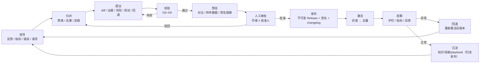

# 06 · PiAgent 自主进化闭环

> “自主进化”不是“让 AI 自己改生产系统”。
> 在本参考包里，它指：**从信号到可发布候选版本的闭环由 Agent 自驱完成，批准与发布仍由人把关。**
> Agent 越靠近“自动”，平台越需要可校验、可灰度、可回退的边界。

---

## 0. 自主性的四个等级

| 等级 | 名称 | Agent 能做什么 | 人做什么 | 适用 |
|---|---|---|---|---|
| **A0** | 只建议 | 读信号，给建议/草稿文本 | 全部手工 | 试点、低信任 |
| **A1** | 起草 + 校验（默认） | 建草稿、写提议、跑校验、生成预览、起草 changelog | 审批、发布、激活 | 所有结构性变更 |
| **A2** | 低风险自动发布 | Agent 仍只起草；平台策略服务按预授权规则自动发布到灰度 | 制定策略、事后复核、看护栏 | 文案/帮助/标签等 |
| **A3** | 结构自动发布 | 自动发布数据模型/流程/权限/工具 | 无 | **禁止** |

**关键区分**：A2 的发布者不是 PiAgent，而是 `release-automation` 策略服务。
Agent 仍然只能提议；`INV-AGENT-04` / `INV-EVO-02` 不被破坏。人制定策略并对结果负责。

**默认 A1**。A2 必须同时满足：

1. 变更类在白名单内（见 §0.1）；
2. 应用级开关显式打开（`autonomy: A2`）；
3. 有灰度与护栏；
4. 有自动回退；
5. 发布后 24h 内有人复核；
6. 连续 N 次无回退才保留资格（N 默认 5）；
7. A2 策略本身经过一次人工审批并纳入审计；修改策略视为高风险变更，不能由 Agent 改。

### 0.1 A2 白名单

| 变更类 | 允许 A2 | 理由 |
|---|---|---|
| 帮助文案、字段提示、错误消息 | ✅ | 不改结构、可回退 |
| changelog 措辞 | ✅ | 不影响行为 |
| 菜单名称/图标（不改权限） | ✅ | 低风险 |
| 表单布局（不增删字段/不改校验） | ✅ | 可用预览验证 |
| 校验消息/提示语 | ✅ | 不改判定 |
| 知识条目（纯操作说明，不含规则/个人数据） | ✅ | 可回退；仍需敏感信息检查与 G5 |
| 新增可选字段 | ⛔ | 涉及数据模型与迁移 |
| 新增页面/流程 | ⛔ | 涉及权限与导航 |
| 规则/审批/权限 | ⛔ | 影响面大 |
| 工具/技能/知识 | ⛔ | 影响 Agent 行为，需评测 |
| 迁移 | ⛔ | 不可逆风险 |

> 白名单是**变更类**的白名单，不是“小改动”的白名单。
> 一行文案如果出现在合同/对账单模板里，也可能有业务后果；所以仍要灰度。

---

## 1. 闭环



**闭环的四个“不”**：

1. 没有证据不提议。
2. 没有校验不预览。
3. 没有审批不发布。
4. 没有观察不算完成。

---

## 2. 信号

### 2.1 三类来源

| 类型 | 例子 | 采集方式 |
|---|---|---|
| 显式反馈 | 点赞/点踩、“这个字段不对”、“少了 X”、“Agent 答错了” | `POST /agent/feedback`、页面反馈按钮 |
| 隐式行为 | 表单放弃、反复搜索无结果、同问题重复问、导出后手工改 | 前端埋点 + 会话分析 |
| 运营信号 | 5xx、工具失败、超时、权限拒绝、慢查询、迁移失败 | 日志/指标/审计 |

### 2.2 反馈记录

```jsonc
{
  "id": "fb_01J...",
  "organizationId": "org_01J...",
  "appKey": "erp-purchase",
  "releaseId": "rel_01J...",
  "cohort": null,
  "userId": "usr_01J...",
  "role": "buyer",
  "screen": { "route": "/purchase/orders/new", "entity": "PurchaseOrder" },
  "traceId": "tr_01J...",
  "toolCallIds": ["tc_01J..."],
  "category": "missing_field | wrong_answer | confusing_ui | bug | feature_request | other",
  "contentMasked": "新建采购单没有税率字段，每次都要问财务",
  "status": "new",
  "createdAt": "2026-10-30T..."
}
```

规则：

- 正文先脱敏再入库；脱敏组件失败则**不记录正文**，只记结构化上下文。
- 反馈是**不可信数据**；Agent 读它时按 `<<<SAP_UNTRUSTED_DATA>>>` 包裹。
- 反馈不能直接触发发布；它只能成为提议的证据。
- 同一用户短时间内重复提交要合并，避免刷屏。

### 2.3 噪声控制

- 聚类前去重：同 org + app + screen + 相似文本 + 24h 内合并。
- 频次阈值：单条反馈可以提议，但优先级低；影响多人的反馈优先。
- 严重度：数据错误/权限/资金 > 流程阻断 > 体验 > 文案。
- 反例：一条“希望增加暗色模式”不应挤掉“对账金额算错”。

---

## 3. 归并（Triage）

Builder Agent 或规则引擎做：

```text
读待处理反馈
  → 按 app/screen/entity/字段/工具聚类
  → 标注：影响角色、频次、严重度、是否重复、是否已有提议
  → 关联指标（该页面放弃率、该工具失败率）
  → 输出候选议题（topic）
```

每个候选议题至少要有：

- 一句话问题陈述；
- 影响的角色/场景；
- 证据列表（反馈 id / 指标 / 错误）；
- 初步变更类型（copy/form/data/flow/rule/permission/agent/knowledge）；
- 建议优先级。

**没有证据的议题不进入提议阶段。**

---

## 4. 提议（Proposal）

### 4.1 提案结构

```jsonc
{
  "id": "chg_01J...",
  "appKey": "erp-purchase",
  "baseReleaseId": "rel_01J...",
  "type": "data",
  "areas": ["data", "form", "agent", "knowledge"],
  "title": "采购单增加税率字段，并让 PiAgent 会填",
  "summary": "新增 taxRate 字段、表单控件、校验、工具参数、答疑口径；旧单默认 0。",
  "diff": {
    "entities": [{ "op": "add", "path": "/semantic/entities/PurchaseOrder/fields/taxRate", "value": { "type": "decimal", "precision": 5, "scale": 2 } }],
    "forms": [{ "op": "add", "path": "/forms/purchase-order/fields/taxRate", "value": { "label": "税率(%)", "required": false } }],
    "tools": [{ "op": "change", "path": "/tools/erp_order_create/parameters/taxRate", "value": { "type": "number", "minimum": 0, "maximum": 100 } }],
    "knowledge": [{ "op": "add", "path": "/knowledge/purchase-order-tax", "value": { "title": "采购单税率填写", "scope": "global" } }]
  },
  "evidence": [
    { "type": "feedback", "ids": ["fb_01J...", "fb_01K..."], "count": 12 },
    { "type": "metric", "name": "form_abandon_rate", "value": 0.34, "window": "14d" }
  ],
  "risk": {
    "level": "medium",
    "breaking": false,
    "permissionChange": false,
    "migration": true,
    "agentBehaviorChange": true,
    "affectedRoles": ["buyer", "finance"],
    "notes": "旧单 taxRate 默认 0；报表需确认是否展示该字段"
  },
  "testPlan": {
    "unit": ["tax-rate.validation.spec.ts"],
    "integration": ["purchase-order.create.spec.ts"],
    "e2e": ["create-order-with-tax"],
    "agentEval": ["query-tax-rate", "create-order-tax"],
    "preview": ["sample-order", "mobile"]
  },
  "rollbackPlan": {
    "strategy": "deactivate-release",
    "dataSafe": true,
    "notes": "新增可空字段，旧版本忽略；无需补偿迁移"
  },
  "createdByAgent": "piagent-builder",
  "createdBy": "usr_01J..."
}
```

### 4.2 硬要求

| 要求 | 判据 |
|---|---|
| 证据 | 至少 1 条反馈/指标/错误；否则拒绝 |
| 差异 | 结构化 Delta，不是自然语言“改一下” |
| 风险 | 必须标 `breaking` / `permissionChange` / `migration` / `agentBehaviorChange` |
| 测试 | 至少一个可执行测试或评测用例 |
| 回退 | 必须写策略；数据不安全要标 `dataSafe:false` |
| 范围 | 只能改目标 app 的草稿；不能跨 app |
| 作者 | 记录 Agent 与发起人；两者都进审计 |

### 4.3 变更类型

| 类型（`type` 为主类型，`areas` 可列多个） | 典型内容 | 默认等级 |
|---|---|---|
| `copy` | 文案、帮助、错误消息 | A2 可自动 |
| `form` | 字段、布局、校验提示 | A1 |
| `data` | 实体、字段、关系、索引、迁移 | A1，必须 G3 |
| `flow` | 状态机、流程边、作业 | A1 |
| `rule` | 校验、审批、记账 | A1，必须 G2/G4 |
| `permission` | 角色、权限点、菜单可见性 | A1，必须安全审批 |
| `agent` | 工具、技能、提示词、知识 | A1，必须 G5 |
| `knowledge` | 答疑口径、操作说明 | A1；低风险可 A2 |

---

## 5. 校验

按 [`04-versioning-release.md`](./04-versioning-release.md) 的 G0–G6 执行。补充：

- **失败必须可解释**：返回哪个闸、哪条规则、哪个字段、怎么修。
- **不允许“带警告发布”**：警告要么修，要么显式降级为 `TD-x` 并有人签字。
- **重复校验要幂等**：同一提议同一版本重复跑，结果一致（模型评测除外，需固定种子/温度）。
- **校验证据要存**：报告、日志、评测结果、预览截图，绑定 `proposalId + digest`。

---

## 6. 预览与人工审核

### 6.1 预览

- 生成 `preview` Release；对业务用户不可见。
- 用脱敏样本数据；关键路径可点。
- 对比模式：旧版/新版并排；标出新增、删除、改文案、改权限、改流程。
- Builder Agent 生成“审阅导览”：先看哪三处、风险在哪、建议重点验证什么。
- 预览链接签名、短 TTL、可撤销。

### 6.2 审批界面

审批人必须看到：

1. **改了什么**：结构化 diff + 业务语言摘要；
2. **为什么改**：证据列表（反馈原文脱敏、指标）；
3. **影响谁**：角色/部门/租户/Agent 能力；
4. **怎么验**：测试/评测/预览结果；
5. **怎么退**：回退策略与数据安全；
6. **谁写的**：Agent + 发起人；作者 ≠ 批准人。

审批动作：`approve` / `reject` / `request changes`。审批人可以**修改后再批准**；修改本身留痕，
作者仍记 Agent/原发起人，批准人记实际修改人。驳回必须写原因；原因回到提议，不丢。

### 6.3 敏感信息闸门

发布前对 changelog、知识条目、示例数据做敏感信息检查（姓名、机构、证件号、手机号、合同片段）：

- 识别出的片段逐条确认“通用名称/已脱敏”才能发布；
- 识别组件降级时**拒绝发布**（fail-closed）；
- 目的是防止反馈原文/客户数据通过“全局知识”扩散。

---

## 7. 发布、激活、观察

### 7.1 发布

- 走 G7/G8；生成不可变 Release、签名、digest、changelog。
- 发布事件写 `app_release_events`。
- 通知：应用负责人、受影响角色、支持团队。

### 7.2 激活

- 默认灰度：5% → 25% → 100%；每档观察窗口 ≥ 24h。
- 观察指标：
  - 业务：任务完成率、关键流程耗时、错误率、人工改单率；
  - Agent：工具成功率、写失败率、答疑差评率、越权拒绝数；
  - 系统：5xx、P95 延迟、队列积压。
- 护栏阈值在激活前配置；未配置则只能人工回退。

### 7.3 自动回退（仅 A2）

满足全部条件才允许：

0. 发布动作由 `release-automation` 执行，`actor_agent` 为空；Agent 不持有 publish 权限；
1. `autonomy=A2` 且变更类在白名单；
2. 阈值显式配置（如 5xx > 1%、任务完成率下降 > 10%）；
3. 回退目标 Release 仍可用且数据兼容；
4. 回退动作本身写审计 + 通知。

默认**不自动回退**；A2 也要先跑一段时间人工观察。

---

## 8. 学习与沉淀

“学习”不是让模型改自己的权重，而是把经验变成**可发布的制品**：

| 学到什么 | 沉淀为 | 生效方式 |
|---|---|---|
| 用户常见问题 | `KnowledgeEntry`（答疑口径） | 发布后下一次提问检索到 |
| 某字段易填错 | 字段提示/校验消息 | 随 Release 生效 |
| 某流程常卡住 | 流程简化/引导 | 随 Release 生效 |
| Agent 选错工具 | 工具描述/示例/评测用例 | 随 SkillSet 发布 |
| 某类反馈反复出现 | 规则/表单/权限调整 | 随 Release 生效 |

**禁止影子学习**：

- 不让 Agent 在会话中“记住”并立即影响其他用户；
- 不把未发布的经验塞进系统提示词；
- 不绕过 Release 直接改知识库；
- 不用“模型升级”代替变更记录。

---

## 9. 一个完整例子

**信号**

> 12 条反馈：新建采购单没有税率字段；PiAgent 被问“税率怎么填”18 次；该表单放弃率 34%。

**归并**

Builder 聚成议题 `purchase-order-tax`，影响 buyer/finance，严重度中。

**提议**

- `data`：`PurchaseOrder.taxRate` decimal(5,2)，可空，默认 0；
- `form`：表单加“税率(%)”，0–100 校验；
- `agent`：`erp_order_create` 加可选参数 `taxRate`；
- `knowledge`：新增“采购单税率填写”口径（全局）；
- `copy`：changelog “新增税率字段，PiAgent 可直接代填”。

**校验**

G0 通过；G1 编译通过；G2 无权限变化；G3 迁移 dry-run 通过（可空字段，`rollbackSafe=true`）；
G4 单测/集成/E2E 通过；G5 Agent 评测：工具选择 96%，写安全 100%，注入 100%；G6 预览关键路径通过。

**审批**

应用负责人批准；因无权限变化，不需要安全审批；作者是 Agent，批准人是人。

**发布与激活**

发布 `1.4.0`；激活 10% 采购员 cohort；观察 24h：表单放弃率降到 18%，无 5xx，Agent 写失败率 0.3%。

**全量**

激活 100%；changelog 推送；12 条反馈标记 `resolved`。

**业务人员侧**

1. 采购员下次登录看到“本次更新：采购单支持税率”的提示；菜单“采购单”带 `UPDATED` 徽标。
2. 打开新建页，看到“税率(%)”字段和提示；PiAgent 侧栏可以回答“税率怎么填”，并引用 v1.4 的知识条目。
3. 采购员说“给这张单加 13% 税率”，PiAgent 生成 Interaction Plan（供应商、明细、税率、含税金额），
   用户确认后写入；返回审计号，页面刷新可见。
4. 财务在使用中提反馈“对账报表也要显示税率” → 新反馈进入下一轮闭环。

**回退演练**

若 24h 内 5xx > 1%：重新激活 `1.3.2`；数据兼容（新增可空字段），无需补偿迁移；
通知用户“已回退到 1.3.2，问题在排查”；反馈重新打开。

---

## 10. 闭环指标

| 指标 | 定义 | 目标 |
|---|---|---|
| 首次响应时间 | 信号 → 首个提议 | < 24h（工作日） |
| 提议通过率 | approved / submitted | 60–85%（太低说明质量差，太高说明门槛松） |
| 一次校验通过率 | validated / first submit | > 70% |
| 变更失败率 | 发布后 7 天内回退/热修比例 | < 5% |
| 回退耗时 | 决定回退 → 恢复服务 | < 15 min |
| 复发率 | 同一议题 30 天内再次出现 | < 10% |
| Agent 答疑解决率 | 未转人工/未重复问 | > 70% |
| 写操作成功率 | 成功 / 尝试 | > 99%（失败要可解释） |
| 越权/未确认写 | 次数 | **0** |

这些指标按月看趋势，不按单次看；单次波动不改变流程。

---

## 11. 不变量（INV-EVO）

| ID | 判据 |
|---|---|
| INV-EVO-01 | 没有证据（反馈/指标/错误）不提议 |
| INV-EVO-02 | Agent 不得批准、发布、激活自己起草的提议 |
| INV-EVO-03 | 每个提议必须有 diff、风险、测试计划、回退计划 |
| INV-EVO-04 | 结构性变更（数据/流程/权限/工具）不得 A2 自动发布 |
| INV-EVO-05 | A2 只允许白名单变更类，由平台策略服务执行（不是 Agent），且必须有应用级开关、灰度、护栏、自动回退 |
| INV-EVO-06 | 自动回退必须有显式阈值；未配置则只能人工回退 |
| INV-EVO-07 | 学习成果必须走发布流程，不得影子生效 |
| INV-EVO-08 | 反馈 → 提议 → 校验 → 审批 → 发布 → 激活 → 回退全链路可追溯 |
| INV-EVO-09 | 同一议题闭环后 30 天内重复出现，必须重新打开并关联旧提议 |
| INV-EVO-10 | Agent 评测回归超过阈值（默认 2%）不得发布 |

---

## 12. 与 `guangfa/validation` 的对应

| 维度 | guangfa/validation | sapbase 本参考包 |
|---|---|---|
| 反馈入口 | 工作台/对话/结果页 | 页面反馈 + PiAgent + 运营指标 |
| 归纳者 | 主 Agent（治理对话） | `piagent-builder` |
| 提议 | 规则变更/新增/经验/数据注记 | `ChangeProposal`（8 类，含数据/表单/流程/权限/工具） |
| 审核 | 主管批准 | 应用负责人；高风险加安全/技术审批 |
| 发布 | 规则集/知识新版本 | 不可变 `Release` + 签名 + changelog |
| 版本 | 只追加 | 只追加 semver + digest |
| 回退 | 旧版本重新发布 | 旧 Release 重新激活 |
| 范围 | 全局/部门/个人 | 平台/组织/cohort/角色 |
| 敏感信息 | 发布前逐条确认 | 同左，且扩展到 changelog/示例数据 |
| 技能集 | sha256 版本 | `skillVersion` + digest |
| 工具契约 | `contracts/tools.json` | **已有**，继续沿用 |
| 不可信数据 | nonce 包裹 | **同左**，沿用并扩展 |
| 我们新增 | — | 预览环境、迁移 dry-run、灰度、Agent 评测、影响面、changelog |

**结论**：治理模式照搬，**影响面更大**，所以闸门更严。
guangfa 改的是“规则/知识”，sapbase 改的是“整个业务系统的结构”，不能只靠一次人工点批准。

---

## 13. 反模式

| 反模式 | 后果 | 正确做法 |
|---|---|---|
| “AI 自动改生产库” | 不可审计、不可回退 | 只能写草稿/提议 |
| Agent 自己批准自己 | 审计失效 | 作者 ≠ 批准人 |
| 用反馈数量代替证据质量 | 噪声驱动变更 | 聚类 + 严重度 + 指标 |
| 发布后不看指标 | 坏了没人知道 | 灰度 + 护栏 + 观察窗口 |
| 把“模型升级”当无事发生 | 行为漂移无记录 | 模型版本进 Release + 评测 |
| 知识库直接生效 | 不可审核/回退 | 知识提议 → 发布 |
| 回退只回代码 | 定义与代码不匹配 | Release + 进程一起回退 |
| A2 越用越宽 | 结构性变更被自动发布 | 白名单只缩不扩；季度审计 |

---

## 14. 最小落地顺序

1. **采集**：`agent_feedback` + 页面反馈按钮 + trace 关联。
2. **只读 Builder**：读反馈、聚类、生成“议题列表”（不提议）。
3. **A0 提议**：生成 `ChangeProposal` 草稿，人复制到 `ai_modules` 手工做。
4. **A1 校验**：接 G0–G4，提议可直接进预览。
5. **A1 发布**：不可变 Release + 审批 + 激活 + changelog。
6. **观察**：灰度 + 指标 + 回退演练。
7. **A2**：只对文案/帮助开自动发布，跑满 5 次无回退再考虑扩类。
