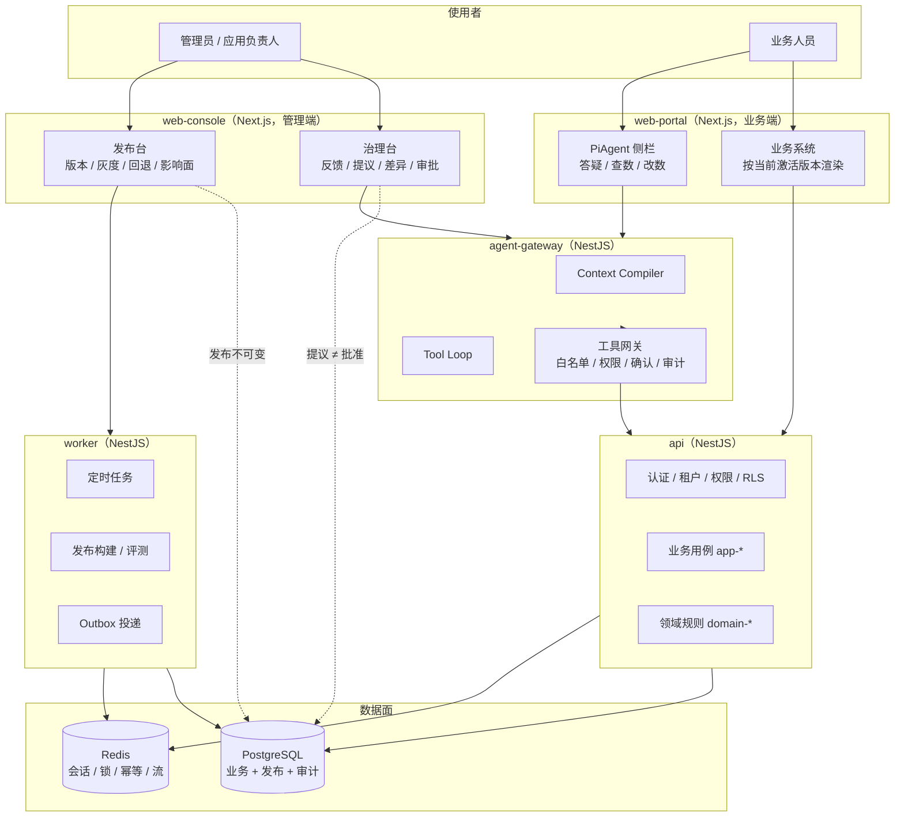

# sapbase 元语系统（参考版 v1）

> 日期：2026-10-30
> 定位：把 sapbase 已有的**定义层**落到 Nx + Next.js + NestJS + PostgreSQL + Redis 工程上的
> **参考实现包**。包含四份机器可校验契约、业务系统版本发布模型、PiAgent 双平面与自主进化闭环。
> 关系：`docs/META_LANGUAGE.md` 仍是**当前真源**；本目录回答“怎么落地、怎么校验、怎么演进”。
> 采用时按 [`07-adoption-and-checks.md`](./07-adoption-and-checks.md) 并入根目录与 CI，
> 然后把本目录降级为历史参考。两者冲突时，以 `docs/META_LANGUAGE.md` 的不变量为准。

---

## 0. 一句话

> **元语系统 = 一套让“词、型、约、证”四层保持一致的工程制度。**
> 词（术语）不漂移，型（元模型）可落地，约（契约）可机器校验，证（测试/审计/发布记录）可追溯。
> PiAgent 只能在这套制度内**提议和操作**；发布权始终在人手里。

### 0.1 需求映射

| 你要的 | 看哪里 |
|---|---|
| 元语/术语/元模型/不变量 | [`01-meta-model.md`](./01-meta-model.md) |
| Nx + Next + Nest + PG + Redis 工程结构 | [`02-architecture.md`](./02-architecture.md) |
| 四份机器可校验契约 | [`03-contracts.md`](./03-contracts.md) + `templates/` + `scripts/` |
| 业务系统多版本、发布、业务人员可见 | [`04-versioning-release.md`](./04-versioning-release.md) |
| PiAgent 答疑、查数、新建/修改数据 | [`05-piagent.md`](./05-piagent.md) |
| 管理员用 AI 更新系统、自主进化闭环 | [`06-evolution-loop.md`](./06-evolution-loop.md) |
| 从现状落地、CI 接入、验收 | [`07-adoption-and-checks.md`](./07-adoption-and-checks.md) |

---

## 1. 为什么参考这两个项目

| 参考 | 借什么 | 不借什么 |
|---|---|---|
| `followup-nx` | Nx 工程分层；`DOMAIN.md` / `FLOWS.md` / `DECISIONS.md` 三份机器可校验契约；cron 三向对拍；`D-x`/`TD-x`/`INV-x` 命名空间；按 `##` 切片读取的 Agent 入口 | 随访领域模型；Prisma/TypeORM 的具体选型；单库单租户的简化 |
| `guangfa/validation` | 反馈 → 主 Agent 归纳 → 提议 → 人工审核 → 发布 → 版本 → 回退的治理闭环；工具白名单；不可信数据包裹；技能集哈希；发布前敏感信息闸门 | 合规审核领域；Spring/Java 技术栈；OpenClaw 的部署细节 |

sapbase 已经有的资产（不要重做）：

| 资产 | 位置 | 在本系统中的角色 |
|---|---|---|
| 元模型 `Ω`、五协议、十三条不变量 | `docs/META_LANGUAGE.md` | 定义层，最高优先级 |
| 工具契约 + 白名单 + 确认令牌 | `contracts/tools.json`、`backend/src/agent-tools/` | PiAgent 执行面的既有地基 |
| Interaction Plan / chat-first 判据 | `docs/protocols/chat-erp.md` | PiAgent 的输出协议 |
| Blueprint 包 / 编译 / 验签 / 摘要 | `backend/src/blueprint/`、`schemas/blueprint-*.json` | 发布物的既有格式 |
| 应用安装 / 升级 / 回滚 / 修订记录 | `backend/src/business-apps/`、`app_installations` | 版本激活的既有地基 |
| AI 模块六步定义 / 测试 / 评审 | `backend/src/ai-modules/` | PiAgent Builder 的既有草稿面 |
| Outbox / RLS / 审计 / Redis | `backend/src/outbox/`、`common/rls/`、`audit-logs/`、`cache/` | 可靠性与隔离地基 |

---

## 2. 四层结构

```text
┌──────────────────────────────────────────────────────────────────┐
│ L0 词层  术语表：一个概念一个词，一个词一个代码标识符              │
│          docs/reference/01-meta-model.md §5                       │
├──────────────────────────────────────────────────────────────────┤
│ L1 型层  元模型 Ω：E/O/R/Φ/Σ/Λ/Γ/Τ/V/C 的工程落点                 │
│          docs/META_LANGUAGE.md §1 + 本目录 01 §2                  │
├──────────────────────────────────────────────────────────────────┤
│ L2 约层  四份机器可校验契约                                       │
│          DOMAIN.md（数据）  FLOWS.md（行为/时间）                   │
│          DECISIONS.md（为什么）  AGENT-TOOLS.md（智能体能做什么）    │
│          + RELEASE（发布不可变，运行时约束）                        │
├──────────────────────────────────────────────────────────────────┤
│ L3 证层  测试 / 审计 / 发布记录 / 评测 / 回退记录                  │
│          check-*.mjs + Jest/Playwright + agent_eval_runs + 审计表  │
└──────────────────────────────────────────────────────────────────┘
```

**判据**：任何一条“约定”如果不能落到 L1 的某个维度、L2 的某份契约或 L3 的某个检查上，
它就不是元语，只是偏好。偏好可以写进风格指南，但不能冒充契约。

---

## 3. 文档地图

| # | 文档 | 回答什么问题 | 主要读者 |
|---|---|---|---|
| 00 | 本文件 | 这套东西是什么、怎么读、和现有文档什么关系 | 所有人 |
| 01 | [`01-meta-model.md`](./01-meta-model.md) | 词怎么定、型怎么落、不变量有哪些、真源在哪 | 架构师、评审者、AI 助手 |
| 02 | [`02-architecture.md`](./02-architecture.md) | Nx/Next/Nest/PG/Redis 怎么分层、依赖怎么走、请求与数据怎么流 | 开发者 |
| 03 | [`03-contracts.md`](./03-contracts.md) | 四份契约的格式、校验规则、失败判据 | 写代码/写文档的人 |
| 04 | [`04-versioning-release.md`](./04-versioning-release.md) | 业务系统怎么版本化、怎么发布、怎么灰度、怎么回退 | 产品、架构、运维 |
| 05 | [`05-piagent.md`](./05-piagent.md) | PiAgent 是什么、双平面怎么分、工具与安全边界在哪 | 后端、Agent 开发、安全 |
| 06 | [`06-evolution-loop.md`](./06-evolution-loop.md) | “自主进化”具体指什么、闭环怎么转、autonomy 分级 | 产品、管理员、Agent 开发 |
| 07 | [`07-adoption-and-checks.md`](./07-adoption-and-checks.md) | 从现状到目标分几步、每步验收什么、CI 怎么接 | 项目负责人 |

配套目录：

```text
docs/reference/
├─ templates/        # 可复制的契约骨架（DOMAIN/FLOWS/DECISIONS/AGENT-TOOLS/提案/发布说明）
└─ scripts/          # 零依赖校验器参考实现 + meta.config 模板
```

---

## 4. 一张图看懂运行面



---

## 5. 十条元规则

这十条是本参考包的“宪法”。后续文档的所有判据都可以回溯到其中一条。

1. **一词一义**：同一概念只允许一个中文名、一个英文名、一个代码标识符；同义词进废弃表。
2. **一处真源**：每个持久事实只有一份权威来源；其他位置只能是引用或派生物。
3. **类型先于提示词**：能用 Schema / 状态机 / 约束表达的，不靠提示词表达。
4. **契约先于实现**：新增能力先改契约（OpenSpec + 本目录对应文档），再写代码。
5. **机器可校验**：契约必须能被脚本对拍；不能对拍的约定降级为风格建议。
6. **失败闭合**：任一闸不过即拒，不部分执行、不静默降级、不回退到“换个方式试试”。
7. **发布不可变**：已发布版本只读；任何修复都产生新版本，不改旧版本。
8. **提议与批准分离**：PiAgent 可以提议、校验、预览；批准与发布只能由有权限的人完成。
9. **权限由平台判定**：模型决定“想做什么”，平台决定“能不能做”；权限、租户、应用上下文不从提示词来。
10. **可追溯、可回退**：每次变更能追到来源证据，每次发布能回退到上一个可用版本。

---

## 6. 状态标记

本目录中的标记只描述**相对 sapbase 当前代码**的状态，不描述愿景。

| 标记 | 含义 |
|---|---|
| ✅ | sapbase 已有可复用资产，或本参考包已给出可运行脚本 |
| 🟡 | 有雏形/部分实现，需要按本文改造 |
| ⬜ | 目标设计，当前未实现 |
| ⛔ | 明确禁止的做法（反模式） |

---

## 7. 最小采用路径

如果只做三件事，按这个顺序：

1. **先立契约**：把根目录的 `DOMAIN.md` / `FLOWS.md` / `DECISIONS.md` 建起来，
   用 `--warn-only` 接入 CI，只报不挡。此时不改任何业务代码。
2. **再锁发布**：在现有 `app_installations` 之上加“不可变 Release + 激活记录 + 变更日志”，
   让“发布”成为一个有状态、可回退的动作，而不是“上传一个包”。
3. **最后放 Agent**：PiAgent 先只做**只读答疑 + 查数**，写操作沿用现有确认令牌；
   等发布与审计稳定后，再开 Builder 的“提议”能力，最后才讨论低风险自动发布。

详细阶段、验收与回滚点见 [`07-adoption-and-checks.md`](./07-adoption-and-checks.md)。

---

## 8. 本参考包的版本

| 版本 | 日期 | 变更 |
|---|---|---|
| v1 | 2026-10-30 | 首版：四契约 + Nx 架构 + Release 模型 + PiAgent 双平面 + 进化闭环 + 校验脚本 |

维护规则：本目录的修改走普通 PR；一旦某份内容被并入根目录真源，就在此标注“已并入”并从参考包中删除，
避免两份文本长期并行。
